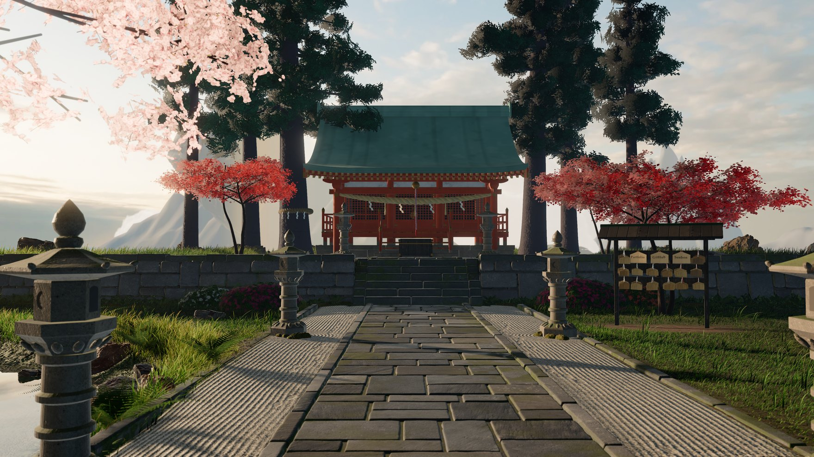

<div align="center">

# Punds

### Everything I do, in one place.

A quiet shrine garden on an island above the clouds, rendered live in the browser. Three plaques on the rack lead to everything else.

[**punds.ch**](https://punds.ch/)

[](https://github.com/dominikkoenitzer/Punds/actions/workflows/ci.yml)
[](./LICENSE)
[](https://react.dev/)
[](https://threejs.org/)
[](https://www.typescriptlang.org/)
[](https://vite.dev/)
[](https://bun.sh/)



</div>

---

## About

**Punds** is my personal hub: one page that points at everything I build. Instead of a list of links it is a place. You stand on the stone path of a small shrine garden, high above a sea of clouds in the late afternoon, and look around.

- **Look around.** Move the pointer toward an edge of the screen, or drag (on a phone, swipe), and the view turns.
- **Explore.** Click the plaque rack, the pond or the shrine and you walk up to it. Esc, the browser's back button or a click elsewhere takes you back to the path.
- **The links** hang on the rack as three wooden plaques: Portfolio, GitHub and Senbon. Point at one and it turns to you on its cord; click it to open it. On a phone the first tap turns it, the second opens it.
- **Touch things.** The plaques swing and knock into each other, a click on the pond drops a ripple, the koi follow you, the shrine bell rings.
- **Sound** is generated in the browser (wind, water, the bell, the wood of the plaques) and stays off until you turn it on with the small "sound" switch or M.

Nothing depends on scrolling. Keyboard and screen-reader visitors get the same three links as a plain list: Tab shows them, and focusing one turns its plaque on the rack.

## How it is made

Everything you see is built when the page loads, from code and a handful of public-domain scans:

- **Light.** A photographed late-afternoon sky lights the scene, with a low sun, soft shadows, ambient occlusion, haze that thickens with distance, gentle bloom and light shafts, and a filmic tone curve.
- **Garden.** The ground blends soil, gravel, moss and pebbles. Grass, cherry, maples and cedars, the shrine, the torii, lanterns, the stone wall and the plaque rack are all generated in code. The rocks are scanned models.
- **Water.** The pond reflects the garden, ripples where you click, and holds a few koi.
- **Sky.** The cloud sea below is raymarched at half resolution and composed back depth-aware, with distant islands and ranges in the haze.
- **Fast first view.** A picture of the start view shows within a fraction of a second while the scene builds, then crossfades into the live garden. Textures arrive at 1k first and sharpen to 2k once the garden is showing.
- **Adaptive quality.** Three tiers (strong desktop, ordinary laptop, phone). A frame-time stepper lowers resolution and effects when a device struggles. Frames are capped at 60, 30 when nothing moves, and none when the tab is hidden. A device that cannot carry the scene gets a still picture with the same links.

## Tech stack

| Layer           | Choice                                       |
| --------------- | -------------------------------------------- |
| Framework       | React 19                                     |
| 3D / rendering  | Three.js (r186), custom shaders and passes   |
| Audio           | Web Audio API, all sounds synthesised        |
| Language        | TypeScript (strict)                          |
| Build tool      | Vite 8                                       |
| Package manager | Bun 1.4.2                                    |
| Styling         | Hand-written CSS                             |

There is no router, no global state and no data layer. The runtime dependencies are `react`, `react-dom` and `three`.

## Getting started

You need [Bun](https://bun.sh/) and a browser with WebGL 2.

```bash
bun install
bun run dev
```

The dev server runs on **http://localhost:1000** and is reachable from other devices on your network.

| Script            | What it does                                                         |
| ----------------- | -------------------------------------------------------------------- |
| `bun run dev`     | Vite dev server on port 1000, exposed on the network.                |
| `bun run build`   | Type-check all project references (`tsc -b`), then build to `dist/`. |
| `bun run lint`    | ESLint over the repository.                                          |
| `bun run test`    | Vitest unit tests (`test:watch` re-runs on change).                  |
| `bun run preview` | Serve the built `dist/` locally.                                     |

Add `?debug` to the address to expose the scene for checks in the console, `?tier=ultra|high|phone` to force a quality tier and `?uncapped` to lift the frame caps.

## Project structure

```
src/
├── main.tsx, App.tsx         # React entry
├── links.ts                  # the three links, in the order they hang
├── pages/Sando.tsx, .css     # the page shell: poster, cursor, sound switch, accessible links
└── realm/                    # the scene
    ├── realm.ts              # host: renderer, camera, sun, looking around, picking, frame caps
    ├── post.ts               # the frame after the scene: AO, haze, bloom, shafts, tone
    ├── island.ts, layout.ts  # build order and the whole composition
    ├── look.ts               # the path view, the close views and the walks between them
    ├── sky.ts, skyscape.ts   # the photographed sky, the cloud sea, far islands and ranges
    ├── terrain.ts, grass.ts, trees.ts, plants.ts, rocks.ts, roots.ts
    ├── shrine.ts, torii.ts, lanterns.ts, stonework.ts, ema.ts, pond.ts
    ├── ambience.ts           # the sounds
    └── assets.ts             # scanned materials, loaded 1k first, 2k after
public/realm/                 # textures, models, sky and the start-view posters
```

To change where the plaques point, edit [`src/links.ts`](src/links.ts). To move anything in the garden, edit [`src/realm/layout.ts`](src/realm/layout.ts).

## Deployment

`bun run build` produces a static `dist/`. It is deployed on Vercel. [`vercel.json`](vercel.json) sets the security headers, including a content security policy that allows WebAssembly for the mesh decoder of the scanned models, and caches hashed assets for good.

## Credits

The scanned materials, models and the sky are public domain (CC0); every source is listed in [CREDITS.md](CREDITS.md).

## License

Licensed under the **Creative Commons Attribution-NonCommercial 4.0 International** license ([CC BY-NC 4.0](./LICENSE)). You are free to share and adapt the material with attribution, but **not** for commercial purposes. The CC0 assets keep their own public-domain terms.

## Author

Built and written by [@dominikkoenitzer](https://github.com/dominikkoenitzer).

If this made you smile, you can support my work via [PayPal](https://www.paypal.com/paypalme/dominikkoenitzer).
